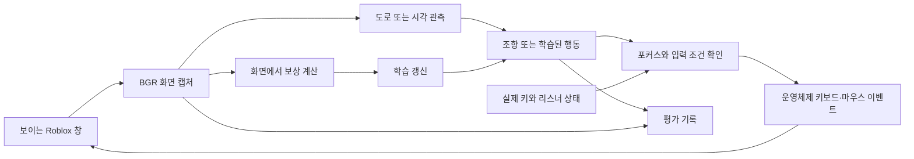
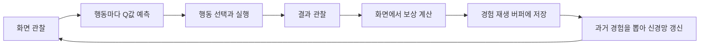

# 아키텍처

언어: [English](ARCHITECTURE.md) | **한국어**

Roblinforce는 사람이 지켜보면서 사용하는 Roblox Driving Empire용 데스크톱 강화학습 프로그램입니다. 화면을 사용하는 Q학습이 주된 기능이며, 모방학습과 표 형태의 조향 학습도 같은 패키지에서 보조 기능으로 제공합니다. 스크린샷으로 게임을 관찰하고 일반적인 키보드·마우스 이벤트로 조작합니다. 게임 메모리 접근, 게임 초기화 API, 지도, 목적지 경로 계획, 충돌 정답 데이터, 검증된 이동 거리 측정 기능은 없습니다.

설치·실행·조작·동작 확인 방법은 [README.md](README.md), 개발자와 코딩 에이전트의 작업 규칙은 [AGENTS.md](AGENTS.md)에서 다룹니다. 유지보수하는 소스 패키지는 `src/roblinforce/` 하나입니다. 이 문서는 영문 아키텍처 문서와 같은 구현을 설명하는 한국어판입니다.

영문 문서의 **supervised**는 사람이 실행을 감시하고 중단할 수 있다는 뜻입니다. 주된 알고리즘은 정답 라벨을 주는 지도학습이 아니라 강화학습입니다. 학습 원리를 먼저 이해하려면 [강화학습의 원리](#강화학습의-원리)부터 읽고, 구현을 확인할 때 모듈과 데스크톱 연동 절을 참고하면 됩니다.

## 모듈별 역할

| 모듈 | 역할 |
| --- | --- |
| `src/roblinforce/cli.py`, `__main__.py` | 강화학습을 중심으로 하고 보조 모드 이름을 구분한 단일 명령 인터페이스. |
| `src/roblinforce/settings.py` | 저장소의 설정 파일과 키 바인딩 검증. |
| `src/roblinforce/calibration.py` | 입력 제어기를 생성하지 않는 도로 색상 미리보기와 저장. |
| `src/roblinforce/road.py` | 보수적인 도로 색상·차선 검출과 보정 화면 표시. 운영체제 입력은 수행하지 않음. |
| `src/roblinforce/desktop.py` | 운영체제별 구현의 지연 선택, 논리 키 이름, 포커스 확인 후 입력, 실제 키 이벤트, 리스너 상태 확인, Retina 화면 크기 정규화. |
| `src/roblinforce/desktop_windows.py` | Win32 클라이언트 영역, 활성 창 확인, SendInput, 실제 키 후크, 포인터 이벤트. |
| `src/roblinforce/desktop_macos.py` | Quartz/AppKit 창 검색, 권한, 활성 창 확인, 키 이벤트 탭, 포인터 이벤트. |
| `src/roblinforce/config.py` | 데이터·체크포인트 경로와 고정된 행동 순서. |
| `src/roblinforce/perception.py` | HOG·시각 관측, 도로 표면 추정, 속도 표시 확인, 차량 메뉴 위치 추정. |
| `src/roblinforce/learning.py` | 모방학습 예측, Q 테이블 갱신, 시각 신경망 학습, 경험 재생, 체크포인트 저장. |
| `src/roblinforce/imitation.py` | 수동 운전 기록, 오프라인 모방학습, 모방학습·Q 테이블 주행 루프. |
| `src/roblinforce/recovery.py` | 포커스와 리스너를 확인하며 중단할 수 있는 차량 선택·캐릭터 재생성 절차. |
| `src/roblinforce/evaluation.py` | 행동·관측 기록, 화면 이미지, 요약 통계, 체크포인트 식별 정보. |
| `src/roblinforce/visual.py` | 시각 정책 제어 루프: 관측, 보상, 행동 선택, 복구, 미리보기. |
| `tests/` | 합성 이미지·모델 테스트와 가짜 데스크톱·제어 루프 통합 테스트. |

데스크톱 구현 분리는 실제 운영체제 차이를 다루기 위한 것입니다. 범용 플러그인 체계를 만들지는 않습니다. 인식과 학습은 일반적인 NumPy/OpenCV 함수로 구성됩니다. 시각 제어 루프는 `DrivingState`의 기존 값을 직접 바꾸는 대신 새 스냅샷을 만들어 제어·캡처·관측·상태 전이·행동 단계로 전달합니다. `DrivingContext`는 고정된 의존성을 보관합니다. 중단 시 진행 중인 추적 정보를 지워, 이후 상태 전이가 오래된 관측을 재사용하지 않도록 합니다.

## 실행 흐름



보조 모방학습과 조향 테이블 모드는 보정한 아스팔트 색과 차선 표시를 사용합니다. 도로 형태를 확신할 수 없으면 경로 추정을 반환하지 않고 주행을 일시 정지합니다. 독립적인 규칙 기반 주행 루프는 제거했지만, 공유하는 인식·보정 기능은 유지했습니다. 시각 모드는 스스로 행동을 선택하며, 도로 검출 결과를 보상과 미리보기에 사용합니다. 도로 검출은 목적지 경로나 반드시 통과해야 하는 주행 허용 조건이 아닙니다.

## 강화학습의 원리

### 기본 생각: 시도하고 결과로 배우기

게임에서 운전을 배운다고 생각해 봅시다. 굽은 도로를 보고 핸들을 꺾은 다음, 차가 도로 위에 남아 있는지 확인합니다. 여러 번 시도하면서 어떤 행동이 도움이 되는지 익힙니다. Roblinforce도 이를 숫자로 반복합니다. 화면을 관찰하고, 행동을 선택하고, 결과를 확인하고, 보상을 계산한 뒤, 다음 행동의 가치를 더 잘 예측하도록 학습합니다.

현재 목표는 **보이는 도로에 잘 정렬된 상태로 계속 움직이는 것**입니다. 개발자가 작성한 보상 함수가 이 목표를 정합니다. 프로그램이 스스로 ‘좋은 운전’의 뜻을 발견하거나 게임에서 보상을 전달받는 것은 아닙니다. 목적지 도착, 충돌 회피, 교통 법규 준수는 현재 측정하는 목표에 들어 있지 않습니다.

| 용어 | 쉬운 뜻 | 이 프로젝트에서의 의미 |
| --- | --- | --- |
| 에이전트, agent | 배우는 주체 | 시각 Q 신경망과 행동 선택 코드. |
| 환경, environment | 행동하는 세계 | 데스크톱을 통해 관찰하고 조작하는 Roblox. |
| 관측·상태, `s` | 지금 볼 수 있는 정보 | 축소한 흑백 픽셀과 이동 여부. 게임 전체의 실제 상태가 아니라 관측 정보임. |
| 행동, `a` | 선택할 수 있는 동작 | 설정된 키 조합 하나 또는 탐색 모드의 키·포인터 동작. |
| 보상, `r` | 즉시 받는 피드백 | 이동·도로 정렬·실패 증거로 계산한 숫자. |
| 정책, policy | 행동을 고르는 방법 | 대개 Q값이 가장 높은 행동을 선택하고, 학습 중에는 일부 무작위 시도. |
| Q값, `Q(s,a)` | 선택이 얼마나 유망한가 | 관측 `s`에서 행동 `a`를 한 뒤 받을 미래 보상을 할인해 더한 값의 예측. 확률이 아님. |
| 상태 전이, transition | 한 번의 경험 | `(s, a, r, next_s, done)`. |



이 방식은 NumPy로 직접 구현한 작은 **DQN(Deep Q-Network)**입니다. 가능한 스크린샷마다 별도의 표를 만드는 대신 신경망으로 Q값을 추정합니다. PyTorch, Gym, Stable-Baselines의 학습 루프는 사용하지 않습니다.

### 1. 화면을 숫자로 바꾸기

`train`과 `evaluate`에서는 [perception.py](src/roblinforce/perception.py)의 `visual_state`가 화면의 가로 8~92%, 세로 12~83% 영역을 잘라 흑백으로 바꾸고 **80×45** 크기로 축소합니다. 각 픽셀은 `pixel / 255 - 0.5`로 변환하여 `-0.5`부터 `+0.5` 사이의 값이 됩니다. 픽셀 3,600개를 한 줄로 펼친 뒤 이동 중이면 `1`, 정지 상태면 `0`을 붙입니다. 입력은 총 **3,601개**입니다.

`explore`와 `evaluate-explore`에서는 전체 화면을 **128×72**로 축소하고 이동 여부를 붙여 **9,217개**를 입력합니다. 도로 정렬 점수는 보상을 계산할 때 사용하며, 별도의 신경망 입력값으로 추가하지 않습니다.

이동 여부는 속도 표시 영역인 HUD(head-up display)의 숫자 모양과 속도 0 템플릿으로 추정합니다. 실제 속도 숫자를 읽는 기능은 아닙니다. 판단할 수 없으면 장면 변화를 보조 신호로 쓸 수 있습니다. 주된 도로 모드에서는 최근 3초 안에 도로를 본 경우에 사용하고, 탐색 모드에서는 더 넓게 허용합니다. 장면 변화는 약 0.4초마다 확인하므로 카메라 움직임을 차량 이동으로 오인할 수도 있습니다.

신경망에는 이미지 한 장과 이동 여부만 들어갑니다. 여러 프레임을 쌓거나 순환 신경망으로 과거를 기억하지 않습니다. 비슷한 화면이라도 실제 속도나 진행 방향은 다를 수 있습니다. 이를 기술적으로 **부분 관측성(partial observability)**이라고 합니다. 다음 결과를 예측하는 데 필요한 정보가 입력에 모두 들어 있지 않다는 뜻입니다.

### 2. 행동마다 가치를 예측하기

도로 정책은 [config.py](src/roblinforce/config.py)에 정해진 순서대로 7개의 값을 출력합니다.

| 인덱스 | 행동 |
| --- | --- |
| 0 | 가속 |
| 1 | 가속 + 좌회전 |
| 2 | 가속 + 우회전 |
| 3 | 좌회전 |
| 4 | 우회전 |
| 5 | 브레이크 |
| 6 | 핸드브레이크 |

행동 이름은 `settings.json`의 키 바인딩으로 연결됩니다. 특정 물리 키 문자로 고정되어 있지는 않습니다. 연속 행동이 같은 키를 사용하면 그 키를 계속 누를 수 있습니다. 이동 여부를 판단할 수 있을 때, 보통 **이동 중에는 최소 0.25초**, **정지 중에는 최소 0.60초**가 지난 뒤 행동의 결과를 한 전이로 기록합니다. 화면 캡처와 처리 시간도 영향을 주므로 일정한 주기로 진행하는 시뮬레이터 스텝은 아닙니다.

신경망은 완전 연결 다층 퍼셉트론(MLP)입니다.

```text
도로 모드:  입력 3,601개 → ReLU 은닉 노드 64개 → Q값 7개
탐색 모드:  입력 9,217개 → ReLU 은닉 노드 64개 → Q값 72개

h = max(0, s @ W1 + b1)
Q(s, :) = h @ W2 + b2
```

`@`는 행렬 곱입니다. `W1`, `W2`는 학습하는 가중치이고 `b1`, `b2`는 학습하는 편향입니다. ReLU는 은닉층의 음수를 0으로 바꿉니다. 합성곱 신경망이나 확률로 변환하는 softmax 층은 없습니다. 체크포인트가 없으면 가중치는 무작위로, 편향은 0으로 시작합니다. 따라서 초기 선택이 운전 실력을 의미하지는 않습니다.

### 3. 새로운 시도와 배운 행동의 균형 잡기

현재 가장 좋아 보이는 행동만 고르면 더 좋은 행동을 발견하지 못할 수 있습니다. **엡실론 탐욕법(epsilon-greedy)**은 일정 확률로 무작위 행동을 시도합니다.

```text
epsilon = max(0.08, 0.40 - 0.32 × steps / 50,000)
```

일반적인 도로 학습의 이동 상태에서는 처음에 40%, 전이 25,000개를 기록하면 24%, 50,000개부터는 8% 확률로 무작위 선택합니다. `steps`는 버퍼를 채우는 초기 구간을 포함한 학습 전이 기록 수입니다. 경과 시간이나 성공한 주행 횟수가 아닙니다. 무작위로 선택해도 우연히 Q값이 가장 높은 행동이 나올 수 있습니다.

탐색 모드의 학습에서는 이 확률을 최소 25%로 유지합니다. 두 시각 학습 모드 모두 정지 상태에서는 최소 65%로 높입니다. 평가 모드에서는 엡실론을 0으로 설정합니다.

탐색 모드에는 사람이 작성한 행동 제한도 있습니다. HUD가 보여 차 안이라고 판단하면 행동 0~2만 선택합니다. HUD가 명확하게 정지 상태를 나타내면 평가 중에도 행동 0을 강제로 선택합니다. 따라서 모든 행동이 신경망의 학습 결과인 것은 아니며, 신경망을 둘러싼 규칙도 동작에 관여합니다.

### 4. 보상 계산하기

도로 검출기는 목표 가로 좌표와 화면 높이별 도로 중심을 추정합니다. 화면 너비를 `w`, 설정된 차량 위치 비율을 `car_x_fraction`이라고 하면 [road_state](src/roblinforce/learning.py)는 다음과 같이 계산합니다.

```text
error = (road_target_x - w × car_x_fraction) / (w / 2)
heading = (far_road_center_x - near_road_center_x) / w
alignment = abs(error) + 0.5 × abs(heading)
```

`error`는 가로 위치 오차, `heading`은 먼 도로 중심과 가까운 도로 중심의 가로 차이로 추정한 방향입니다. `abs`는 절댓값입니다. `alignment`는 단위가 없는 이미지 기반 점수이며 작을수록 좋습니다. `0.25`는 판단 기준이지 성공률 25%, 미터 단위 거리, 조향 각도가 아닙니다.

[visual.py](src/roblinforce/visual.py)의 `transition_reward`와 실패 처리에서 사용하는 보상은 다음과 같습니다.

| 결과 | 기본 보상 |
| --- | --- |
| 이동 중이고 `alignment <= 0.25` | `0.20 + 0.40 × (1 - alignment / 0.25) + min(0.10, 2 × visual_change)` |
| 이동 중이지만 정렬 점수가 없거나 `0.25`보다 큼 | `-0.25` |
| 움직이지 않거나 보상 함수에 전달된 이동 여부가 불명확함 | `-0.20` |
| 이동 신호를 인식하지만 약 20초 동안 정지 상태가 계속됨 | `-2.00`, 종료 전이 |
| 이동 증거가 0.6초 이상 없고 원인을 연결할 수 있는 직전 행동이 남아 있음 | `-3.00`, 종료 전이 |

`visual_change`는 이전·다음 정규화 이미지의 픽셀별 차이에 절댓값을 취한 평균입니다. 이동 여부 값은 제외합니다. 정렬된 이동 조건을 만족할 때만 최대 `+0.10`을 추가합니다. 따라서 양의 기본 보상 범위는 `+0.20`부터 `+0.70`입니다.

예를 들어 차가 움직이고, `alignment = 0.10`, `visual_change = 0.03`이면 보상은 `0.20 + 0.40 × 0.60 + 0.06 = 0.50`입니다. 반면 움직이더라도 정렬 점수가 `0.30`이면 `-0.25`입니다. 학습기는 이 차이를 이용해 더 잘 정렬되는 행동의 가치를 높일 수 있습니다.

탐색 모드는 **HUD가 없을 때 처음 보는 거친 이미지 특징에 `+0.30`**을 추가합니다. BGR 화면을 16×9로 줄이고, 픽셀 값을 32 간격의 구간으로 묶어 해시를 계산합니다. 실행 중 최대 200,000개의 특징을 메모리에 보관합니다. HUD가 없을 때는 장면 변화만으로 보상 계산상의 차량 이동을 인정하지 않습니다. 따라서 기본값이 보통 `-0.20`이고, 새로운 화면이면 합계 `+0.10`을 받을 수 있습니다. 정체 전이는 새로움 보상에 관계없이 `-2.00`으로 덮어씁니다. 이 보상은 다른 화면을 시도하도록 유도하지만 메뉴를 여는 행동도 보상할 수 있습니다.

`done = True`는 해당 전이에서 미래 보상을 더하지 않는다는 뜻입니다. 정체·관측 상실 증거로 정한 학습 경계이며, Roblox의 게임 종료 신호나 실제 충돌 확인 결과가 아닙니다. 관측 상실 처리에서는 마지막 상태를 `next_s`로 재사용하지만 `done`이 미래 가치 항을 제거합니다. 일시 정지 같은 중단은 진행 중인 추적을 지우며, 중단된 모든 행동을 학습 경험으로 기록하지는 않습니다.

### 5. 최근 경험으로 학습하기

한 번의 결과에는 우연이 섞입니다. **경험 재생(experience replay)**은 최근 전이 최대 2,000개를 보관하고 그중 서로 다른 저장 항목 32개를 무작위로 뽑아 한 번 학습합니다. 경험을 섞으면 비슷한 연속 화면만 받는 영향을 줄일 수 있습니다. 다만 경험의 다양성이나 정확성을 보장하지는 않습니다.

처음 전이 31개는 가중치를 바꾸지 않고 버퍼만 채웁니다. 32번째부터 새 전이를 기록할 때마다 미니배치 학습을 한 번 수행합니다. 현재 정책이라면 다르게 행동할 과거 경험도 사용할 수 있으므로 **오프폴리시(off-policy)** 방식입니다.

뽑은 각 경험의 학습 목표값은 다음과 같습니다.

```text
y = r + gamma × (1 - done) × max_a Q_target(next_s, a)
gamma = 0.95
```

뜻은 **지금 선택한 행동의 가치를 ‘지금 받은 보상 + 다음에 받을 수 있는 보상의 약간 할인된 예측’에 가깝게 만든다**는 것입니다. `r = 0.50`, 다음 상태의 가장 높은 Q값이 `2.00`, 종료 전이가 아니라면 `y = 0.50 + 0.95 × 2.00 = 2.40`입니다. 현재 선택한 행동의 예측이 `1.00`이었다면 갱신은 그 값을 높이는 방향으로 작용합니다. Q값 `2.40`은 성공 확률 240%라는 뜻이 아닙니다.

종료 전이는 `done = 1`이므로 `y = r`이 됩니다. 할인은 초당이 아니라 기록된 전이마다 한 번 적용합니다. 목표값 계산에서 행동 시간의 차이를 별도로 반영하지는 않습니다.

현재 행동을 예측하는 **온라인 신경망**은 미니배치마다 학습합니다. 별도의 **목표 신경망(target network)**이 `Q_target`을 제공하며 **학습 전이 200개를 기록할 때마다** 온라인 가중치로 교체합니다. 매 계산 직후 정답지를 고치는 대신 잠시 고정된 정답지를 참고하는 것처럼, 목표값이 너무 빠르게 변하는 것을 줄입니다. 두 신경망은 같은 가중치로 시작합니다.

[train_visual](src/roblinforce/learning.py)은 역전파를 직접 계산합니다.

```text
delta = clip(Q_online(s, a) - y, -1, +1)
선택한 출력의 기울기 = delta / 32
출력층과 ReLU를 거꾸로 통과하며 기울기 계산
각 가중치·편향 = 기존 값 - 0.005 × clip(해당 기울기, -1, +1)
```

`clip`은 범위를 벗어난 값을 경계값으로 제한합니다. 과도하게 큰 수정량을 줄이는 역할입니다. 예측 오차를 잘라 쓰는 미분은 Huber 손실과 유사하지만, 코드가 손실값 보고서를 계산하지는 않습니다. Adam이나 모멘텀 없이 기본 경사하강법을 사용합니다. 한 샘플에서 선택하지 않은 출력의 직접적인 출력 기울기는 0이지만, 공유하는 은닉 가중치가 바뀌므로 다른 행동·관측의 예측도 바뀔 수 있습니다.

### 6. 무엇을 배우고 저장하며 측정하는가?

학습은 `w1`, `b1`, `w2`, `b2` 네 배열을 바꿉니다. 시각 패턴과 미래 보상의 관계를 배우며, 지도를 작성하거나 이름 있는 목적지를 학습하지는 않습니다. 체크포인트에는 `steps`와 `best_streak`도 저장합니다. `best_streak`는 도로에 정렬되어 움직였다고 관측한 최장 연속 시간입니다. 진단용 값이지 추가 보상 항이나 독립적인 거리 측정값은 아닙니다.

시각 학습은 전이 100개마다, 그리고 정상적인 정리 과정에서 저장합니다. 경험 재생 버퍼, 목표 신경망 스냅샷, 난수 생성기 상태, 탐색 모드의 새 화면 집합은 저장하지 않습니다. 재실행하면 가중치와 카운터는 이어지지만 버퍼는 비어 있고 목표 신경망은 읽어 온 온라인 가중치로 초기화합니다. 따라서 중단 전 학습 과정을 완전히 같은 순서로 재현하지는 않습니다.

평가(`evaluate`, `evaluate-explore`)는 해당 모드의 기존 체크포인트를 읽고 무작위 탐험과 가중치 학습을 끕니다. 체크포인트를 저장하지 않고 관찰 기록을 남깁니다. 입력 제한과 복구 규칙은 계속 실행합니다. Q값이 가장 높은 행동을 고르더라도 게임·시간·화면 인식·복구 결과가 달라질 수 있으므로, 게임 전체가 결정적으로 재현되는 것은 아닙니다.

### 7. 보조 학습 모드

`train-steering`은 작은 **표 기반 Q학습(tabular Q-learning)** 실험입니다. 도로 가로 오차를 9구간, 방향을 5구간으로 나누어 45가지 상황을 만들고, 각 상황에 조향 선택 3개를 둡니다. 갱신식은 `Q <- Q + 0.2 × (r + 0.8 × max Q(next_state) - Q)`이며, 종료 갱신에서는 미래 항을 뺍니다. 일반적인 이동 전이에서는 `r = 2 × (previous_alignment - alignment) - 0.005 × abs(previous_action)`으로 정렬 개선에 보상을 줍니다. 표 주변에 규칙 기반 기본 조향, 제한적인 무작위 탐험, 일시 정지 조건이 있습니다. 시각 DQN 정책과는 별개입니다.

`record` → `train-imitation` → `drive-imitation`은 **모방학습(imitation learning)**입니다. 사람이 운전하며 기록한 조향이 정답 라벨이고, HOG 특징이 가까운 예시 7개가 좌회전·직진·우회전에 투표합니다. HOG는 이미지 경계선 방향을 표현하는 특징입니다. 이 과정은 시각 보상이나 DQN 갱신을 쓰지 않으며, 기록한 데이터가 시각 신경망을 자동으로 초기화하지도 않습니다. 모든 모드가 소스 모듈은 공유하지만 모델 형식과 파일은 구분합니다.

### 8. 현재 학습 설정 요약

다음은 현재 코드를 설명하는 값입니다. 대부분은 `settings.json` 옵션이 아니라 구현 안의 상수입니다.

| 설정 | 현재 값 |
| --- | --- |
| 도로·탐색 입력 크기 | 3,601 / 9,217 |
| 은닉층 | ReLU 노드 64개 |
| 도로·탐색 출력 크기 | 7 / 72 |
| 경험 재생 용량·미니배치 | 전이 2,000개 / 32개 |
| 할인율 `gamma`·경사하강 학습률 | `0.95` / `0.005` |
| 예측 오차·파라미터 기울기 제한 | 각 성분을 `[-1, +1]`로 제한 |
| 목표 신경망 복사·체크포인트 저장 | 학습 전이 200개 / 100개마다 |
| 기본 무작위 탐험 확률 | 전이 50,000개 동안 40%에서 8%로 감소 |
| 탐색·정지 상태의 탐험 확률 하한 | 학습 중 25% / 65% |
| 일반적인 행동 결과 관측 간격 | 이동 중 최소 0.25초 / 정지 중 최소 0.60초 |
| 정체·직전 행동의 관측 상실 종료 기준 | 약 20초 / 최소 0.6초 |

### 9. 발전 여부와 한계 해석하기

보상은 실제 목표 대신 쉽게 측정할 수 있는 **대리 지표(proxy)**입니다. 카메라 애니메이션이 이동처럼 보이거나, 도로 오인식이 잘못된 보상을 주거나, 새로움 보상이 메뉴 조작을 유도할 수 있습니다. 이미지 한 장으로 실제 속도를 알 수 없고, 충돌·경로 완수의 실제 정답 신호도 없습니다. 학습을 많이 하면 잘못된 피드백까지 강화할 수 있습니다.

탐색 모드 출력 72개는 운전 행동 7개, 문자·숫자 키 31개, 추가 키 6개, 격자 클릭 24개, 스크롤 행동 4개로 구성됩니다. 행동 선택 시 차 안에서는 선택지를 제한하지만, 학습 목표의 최댓값은 그 제한 없이 **다음 상태의 출력 72개 전체**에서 구합니다. 이 차이 때문에 다음 상태 가치를 과대평가할 수 있습니다. 현재 구현은 기본 DQN이며 Double DQN이 아니고 수렴을 보장하지 않습니다.

차량 선택, 재생성, 권한 확인, 포커스 확인, 수동 중단은 사람이 작성한 규칙입니다. 신경망이 이런 제어·안전 장치를 학습하지 않습니다. 특히 복구 절차가 실행을 이어 주기 때문에 운전 정책이 약해도 겉으로는 오래 동작하는 것처럼 보일 수 있습니다.

개선을 확인하려면 비슷한 조건에서 고정된 체크포인트를 [평가 기록](#평가-기록)으로 비교합니다. 화면으로 확인한 정렬 이동 시간이 늘고, 정지·관측 상실·복구 시도가 줄었는지 봅니다. 합계뿐 아니라 이미지를 확인하고 여러 번 반복하며, 평가 전후 체크포인트 해시가 같은지 확인합니다. 이는 실용적인 관찰 방법이며 안전하거나 일반적인 운전 능력의 증명은 아닙니다.

## 데스크톱 연동 계약

운영체제 라이브러리는 데스크톱 동작을 시작할 때 지연 로딩합니다. CLI 도움말과 오프라인 학습은 키보드 후크나 게임 창을 요구하지 않습니다. Windows는 `ctypes`, macOS는 PyObjC의 Quartz·AppKit 바인딩을 사용합니다. 조건부 의존성으로 Windows에는 PyObjC를 설치하지 않습니다. [PyObjC Quartz 설명](https://pyobjc.readthedocs.io/en/latest/apinotes/Quartz.html)을 참고할 수 있습니다.

공유 키 코드는 Windows 가상 키 정수를 **논리 식별자**로 사용합니다. macOS 구현이 이를 Quartz 하드웨어 키 코드로 바꿉니다. 실제 키 리스너는 프로그램이 생성한 입력을 무시하여, 출력한 W/A/D가 수동 개입으로 오인되지 않게 합니다. 리스너가 시작에 실패하거나 예기치 않게 종료되면 입력을 중단하는 방향으로 실패해야 합니다.

새 키·포인터 입력 전에는 게임 창이 활성 상태인지 확인합니다. 키 해제는 포커스를 잃은 뒤에도 허용합니다. 포인터 입력은 현재 창 영역을 확인하고 그 밖의 좌표를 거부합니다. 복구 절차도 단계 사이에 중단 여부를 확인합니다. 다만 운영체제 호출 도중 포커스가 바뀌는 시간차는 데스크톱 자동화의 한계로 남습니다.

공유 캡처 영역과 포인터 위치는 논리 데스크톱 좌표를 사용합니다. `capture_frame`은 복사된 BGR 배열을 해당 영역 크기로 맞춰 반환합니다. Retina 캡처가 더 많은 물리 픽셀을 갖는 경우도 포함합니다. Windows는 클라이언트 영역을 캡처하지만 macOS는 현재 장식 영역을 포함한 보이는 창 경계를 사용합니다. 이 차이는 화면 비율로 잡는 HUD·도로 위치를 바꿀 수 있으므로 macOS 수동 확인 대상입니다. 창 크기 변경, 특이한 모니터 배치, 게임 UI 변경, 가려진 화면도 인식을 무효화할 수 있습니다.

macOS 시작 시 화면 기록(Screen Recording), 손쉬운 사용(Accessibility), 입력 모니터링(Input Monitoring) 권한을 확인합니다. 사용자가 시스템 설정에서 권한을 부여하며 프로그램이 개인정보 보호 설정을 바꾸지 않습니다. 권한 부여 후 실행 앱을 재시작해야 할 수 있습니다. 이벤트 탭과 입력 전송은 [Apple Quartz Event Services](https://developer.apple.com/documentation/coregraphics/quartz-event-services)를 따릅니다.

## 소스 배치와 파일 생명주기

지원하는 배포 방식은 저장소를 수정 가능 모드(editable)로 설치하는 것입니다. `config.py`는 자신의 소스 위치를 기준으로 `ROOT`를 저장소에 고정합니다. 현재 작업 디렉터리를 바꿔도 설정·모델 경로가 바뀌지 않습니다. `settings.py`는 `ROOT/settings.json`을 읽습니다. 소스 배치를 전제로 하므로 독립적인 wheel 설치는 지원하는 실행 배포 방식이 아닙니다.

`models/`에는 쓰기 가능한 체크포인트, `data/`에는 운전 기록과 평가 결과를 저장합니다. 저장할 때 없는 출력 디렉터리를 생성합니다. 속도 HUD 템플릿은 `src/roblinforce/assets/`, 개발 참고 이미지는 `work/`에 있습니다. 과거 빌드·실행 파일은 Git에서 제외한 `artifacts/legacy/`에 보관하며 현재 애플리케이션 소스나 출시 검증 결과가 아닙니다.

통합 CLI는 실시간 시각 학습 `train`과 오프라인 모방학습 `train-imitation`을 구분합니다. 설치된 `roblinforce` 명령과 `python -m roblinforce`는 같은 디스패처를 호출합니다. 버전별 실행 래퍼는 없습니다. 기존 모델 배열과 행동 순서는 변환 없이 이동했습니다.

## 학습 모드와 저장 형식

| 실험 | 관측과 정책 | 저장 결과 |
| --- | --- | --- |
| 수동 모방학습 | 정규화한 HOG 특징, 가까운 예시 7개의 좌회전·직진·우회전 투표. | `data/drive-*.npz`, 이후 `x`·`y` 배열을 가진 `models/model.npz`. |
| 조향 테이블 | 가로 오차 9구간 × 방향 5구간 × 조향 행동 3개. | `q`·`visits`를 가진 `models/steering_q.npz`. |
| 시각 도로 목표 | 잘라 낸 흑백 80×45 픽셀과 이동 여부, ReLU 은닉 노드 64개, 행동 7개. | `models/road_goal_agent.npz`. |
| 게임 탐색 | 전체 화면 흑백 128×72 픽셀과 이동 여부, 같은 은닉층 크기, 행동 72개. | `models/game_explorer_agent.npz`. |

시각 체크포인트는 `w1`, `b1`, `w2`, `b2`, `steps`, `best_streak`를 유지합니다. 가중치·편향 형상은 도로 목표에서 `(3601, 64)`, `(64,)`, `(64, 7)`, `(7,)`이고, 탐색에서는 `(9217, 64)`, `(64,)`, `(64, 72)`, `(72,)`입니다. 읽을 때 형상이 다르면 거부합니다. NumPy 압축 파일은 pickle 없이 읽습니다. 시각 체크포인트는 임시 파일을 저장한 뒤 최종 파일을 교체합니다. 경험 재생은 메모리에서만 유지하고 2,000개로 제한하며 체크포인트에 넣지 않습니다.

갱신 수식과 설정은 [강화학습의 원리](#강화학습의-원리)에서 설명합니다. 새 정책 스냅샷으로 모델 변경을 명확히 합니다. 과거 이동 여부 중심 모델 `models/visual_agent.npz`는 현재 도로 목표 모드에서 사용하는 체크포인트가 아닙니다.

## 평가 기록

평가는 해당 체크포인트를 읽고 각 모드의 행동 제한 안에서 탐욕적 선택을 합니다. 학습 함수를 호출하거나 체크포인트를 저장하지 않습니다. 실행마다 다음을 기록합니다.

- `actions.csv`: 완료 여부를 알기 전에 선택하고 시도한 행동.
- `steps.csv`: 완료된 행동의 관측, 대리 보상, 이동·정렬, 소요 시간, 행동 ID.
- `frames/*.jpg`: 검토할 결과 화면.
- `summary.json`: 체크포인트 경로·해시, 행동·전이 수, 정렬 이동 시간, 정렬되지 않은 이동 시간, 정지 시간, 차량 관측 상실, 복구 시도 수.

출력 위치는 `data/evaluations/<timestamp>/`입니다. 두 CSV는 측정 대상이 다릅니다. 행동을 시도했어도 완료된 전이가 없을 수 있습니다. 지표는 화면 기반 추정이며 검증된 이동 거리나 충돌 횟수가 아닙니다. 평가 전후 체크포인트 해시를 비교하고 비슷한 조건에서 반복한 화면을 검토한 뒤 품질을 판단해야 합니다.

## 안전과 실패 시 동작

모든 실시간 주행은 일시 정지 상태로 시작합니다. 제어 루프는 자신이 누른 키를 관리하며, 일시 정지·수동 개입·포커스나 창 상실·종료 시 해제합니다. 도로를 따르는 보조 모드는 도로 확신이 부족하면 멈춥니다. 시각 모드는 도로 밖에서도 학습하거나 복구를 재시도할 수 있습니다. 활성 상태에서 포커스만 잃었다면 Roblox가 다시 활성화될 때 재개할 수 있습니다.

일반 모드는 F9 정지를 지원하지만 자유 탐색과 그 평가 모드는 기존의 F9 비활성 동작을 유지합니다. 실제 운전 키·Esc와 미리보기 창 닫기로 중단할 수 있습니다. F9는 프로그램 입력을 해제하며 차량에 브레이크를 걸지는 않습니다. Python 프로세스·운영체제 이벤트 탭/후크·게임이 실패할 수 있으므로 프로세스 정지나 강제 종료 후 정리를 소프트웨어만으로 보장할 수는 없습니다.

차량 복구는 메뉴 형태를 인식하고 F/T, 차량 분류·카드 클릭, 메뉴 닫기를 시도합니다. 차량 관측이 오래 사라지면 Esc/R/Enter로 캐릭터 재생성을 요청할 수 있습니다. 특정 게임 UI에 맞춘 휴리스틱 규칙입니다. 현재 Windows/macOS Roblox에서 성공하는지는 실제 실행으로 확인해야 하며 스크린샷 테스트만으로 보증할 수 없습니다.

## 검증 범위

자동 검증은 실제 화면 캡처나 입력 없이 순수 함수, 저장·읽기, 가짜 Windows/Quartz 호출, 모의 제어 흐름을 다룹니다. 빌드·린트·테스트 명령과 실제 동작 확인 절차는 README에 있습니다. 유지보수하는 운영체제별 실행 파일 배포는 없으며 과거 EXE·빌드 결과는 현재 배포물이 아닙니다. 경로 계획, 현재 위치 추정, 숫자 속도 인식, 충돌 검출, 전체 학습 대시보드는 현재 기능이 아니라 향후 작업 범위입니다.
