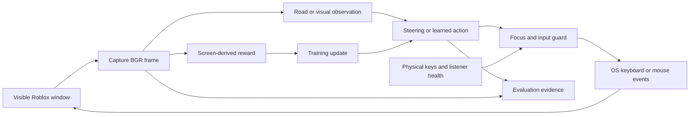
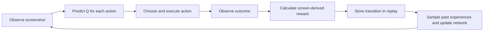

# Architecture

Languages: **English** | [한국어](ARCHITECTURE-KO.md)

Roblinforce is a supervised desktop reinforcement-learning application. Visual Q-learning is the primary workflow; imitation learning and tabular steering are auxiliary modes in the same package. It observes Roblox through screenshots and controls it through normal keyboard/mouse events. It has no game-memory access, reset API, map, destination planner, collision labels, or verified distance measurement.

Installation, launch commands, controls, and acceptance checks belong in [README.md](README.md). Contribution rules belong in [AGENTS.md](AGENTS.md). Learning-mode procedures are consolidated in the README; there is one maintained source package under `src/roblinforce/`.

Here, **supervised** means a person watches and can interrupt the live application. The primary algorithm is reinforcement learning, not supervised learning from correct-answer labels. Start with [Reinforcement learning explained](#reinforcement-learning-explained) for the learning principle; the module and desktop sections explain how it is implemented.

## Module responsibilities

| Module | Responsibility |
| --- | --- |
| `src/roblinforce/cli.py`, `__main__.py` | One RL-first command interface, with explicit auxiliary commands. |
| `src/roblinforce/settings.py` | Repository-local settings and key-binding validation. |
| `src/roblinforce/calibration.py` | Road-color preview and persistence without an input controller. |
| `src/roblinforce/road.py` | Conservative road-color/lane-marking detection and calibration preview rendering. No native desktop input. |
| `src/roblinforce/desktop.py` | Lazy backend selection, logical key names, focus-guarded input, physical-key events, listener health, and Retina frame normalization. |
| `src/roblinforce/desktop_windows.py` | Win32 client geometry, foreground checks, SendInput, physical key hook, and pointer events. |
| `src/roblinforce/desktop_macos.py` | Quartz/AppKit window discovery, permissions, foreground checks, key event tap, and pointer events. |
| `src/roblinforce/config.py` | Existing data/checkpoint locations and fixed action spaces. |
| `src/roblinforce/perception.py` | HOG/visual observations, road-surface estimates, speed-HUD checks, and car-menu geometry. |
| `src/roblinforce/learning.py` | Imitation prediction, tabular updates, visual network updates, bounded replay, and checkpoint persistence. |
| `src/roblinforce/imitation.py` | Manual recording, offline imitation training, and imitation/tabular driving loops. |
| `src/roblinforce/recovery.py` | Interruptible vehicle-menu/character-respawn sequences with focus and listener checks. |
| `src/roblinforce/evaluation.py` | Action/step evidence, sampled frames, summary totals, and checkpoint identity. |
| `src/roblinforce/visual.py` | Visual policy control loop: observations, reward, action selection, recovery, and preview. |
| `tests/` | Synthetic perception/model tests and fake desktop/control-loop integration. |

The desktop backends are a real OS boundary, not a general plugin framework. Perception and learning remain ordinary NumPy/OpenCV functions. The visual loop passes an immutable `DrivingState` snapshot through control, capture, observation, transition, and action phases; `DrivingContext` holds its fixed dependencies. Interruption clears tracking before a later transition can reuse stale observations.

## Runtime flow



Auxiliary imitation and tabular steering use calibrated asphalt and plausible lane markings. Uncertain geometry returns no path and pauses driving. The standalone rule-based driving loop has been removed; its shared perception and calibration remain. Visual modes choose their own actions; their road detector supplies reward/preview evidence rather than a route or a hard road-confidence gate.

## Reinforcement learning explained

### The idea: practice with feedback

Imagine learning to drive in a game. You see a bend, try steering, and then check whether the car stayed on the road. Over many attempts, you learn which actions tend to help. Roblinforce repeats a numerical version of this process: observe a screenshot, choose an action, observe the result, assign a reward, and adjust its predictions.

The current objective is **to keep moving while aligned with the visible road**. The program supplies this objective through a hand-written reward function. It does not discover the meaning of good driving by itself, and the game does not provide the reward. Reaching a destination, avoiding collisions, and following traffic rules are not measured objectives in this implementation.

| Term | Everyday meaning | Meaning in this project |
| --- | --- | --- |
| Agent | The learner | The visual Q-network and action-selection code. |
| Environment | The world it acts in | Roblox, observed and controlled through the desktop. |
| Observation/state, `s` | What it can see now | Reduced grayscale pixels plus a movement flag. This is an observation, not the complete game state. |
| Action, `a` | A choice | One configured key combination, or an explorer key/pointer action. |
| Reward, `r` | Immediate feedback | A number calculated from movement, road alignment, and failure evidence. |
| Policy | How it chooses | Usually take the highest-Q action, sometimes try a random action during training. |
| Q-value, `Q(s,a)` | How promising a choice looks | Predicted discounted sum of future rewards after action `a` in observation `s`. It is not a probability. |
| Transition | One experience | `(s, a, r, next_s, done)`. |



This is a small **Deep Q-Network (DQN)** implementation written directly with NumPy. A neural network estimates Q-values instead of keeping a separate table for every possible screenshot. No PyTorch, Gym, or Stable-Baselines training loop is used.

### 1. Turn the screenshot into numbers

For `train` and `evaluate`, `visual_state` in [perception.py](src/roblinforce/perception.py) takes the horizontal 8–92% and vertical 12–83% of the frame, converts it to grayscale, and resizes it to **80×45**. Each pixel becomes `pixel / 255 - 0.5`, putting it between `-0.5` and `+0.5`. The image is flattened into 3,600 numbers, followed by `1` for moving or `0` for stopped: **3,601 inputs** in total.

For `explore` and `evaluate-explore`, the full frame is resized to **128×72**, producing **9,217 inputs** including the flag. Road alignment is used to calculate reward; it is not appended as a separate network input.

Movement is estimated from the speed display (HUD: head-up display), using digit shapes and a zero-speed template. It does not read a numerical speed. If this evidence is unknown, scene changes can provide a fallback: the main road mode requires a road sighting within the last 3 seconds, while the explorer permits the fallback more broadly. Scene motion is sampled about every 0.4 seconds; camera movement can therefore be mistaken for vehicle movement.

The network sees one image and a movement flag, without stacked frames or recurrent memory. Similar images can represent different speeds or directions of travel. In technical terms, this is **partial observability**: the input does not contain everything needed to predict the next outcome.

### 2. Predict the value of each action

The road policy has seven outputs in the stable order defined in [config.py](src/roblinforce/config.py):

| Index | Action |
| --- | --- |
| 0 | Accelerate |
| 1 | Accelerate + left |
| 2 | Accelerate + right |
| 3 | Left |
| 4 | Right |
| 5 | Brake |
| 6 | Handbrake |

These are logical actions mapped through `settings.json`; they are not fixed physical key letters. Consecutive actions may keep a shared key held. When movement is known, an action normally produces a completed transition after at least **0.25 seconds if moving**, or **0.60 seconds if stopped**, subject to capture and processing time. This is not a fixed-rate simulator step.

The network is a fully connected multilayer perceptron (MLP):

```text
Road:      3,601 inputs → 64 ReLU units → 7 Q-values
Explorer:  9,217 inputs → 64 ReLU units → 72 Q-values

h = max(0, s @ W1 + b1)
Q(s, :) = h @ W2 + b2
```

`@` is matrix multiplication. `W1` and `W2` are learned weights; `b1` and `b2` are learned biases. ReLU replaces negative hidden values with zero. There is no convolutional network or softmax probability layer. Without a checkpoint, weights start randomly and biases start at zero; early choices do not represent learned driving skill.

### 3. Balance trying and using what was learned

Always choosing the current favorite can prevent the agent from discovering a better action. **Epsilon-greedy selection** occasionally tries a random action instead:

```text
epsilon = max(0.08, 0.40 - 0.32 × steps / 50,000)
```

For ordinary moving road training, this means a 40% random-choice probability initially, 24% at 25,000 recorded transitions, and 8% from 50,000 onward. `steps` counts recorded training transitions, including the initial replay warm-up; it is not elapsed time or a count of successful drives. Random selection can also happen to pick the highest-Q action.

During explorer training, epsilon is at least 25%. During either visual training mode, a stopped observation raises it to at least 65%. Evaluation sets epsilon to zero.

There are also hand-written explorer restrictions. When the HUD indicates the agent is in a car, choices are limited to actions 0–2. If the HUD specifically indicates stopped, action 0 is forced, including in evaluation. Thus some behavior comes from rules around the network, rather than its learned predictions.

### 4. Calculate the reward

The road detector estimates a target horizontal coordinate and road centers at different image heights. Given frame width `w` and configured vehicle position `car_x_fraction`, [road_state](src/roblinforce/learning.py) calculates:

```text
error = (road_target_x - w × car_x_fraction) / (w / 2)
heading = (far_road_center_x - near_road_center_x) / w
alignment = abs(error) + 0.5 × abs(heading)
```

`alignment` is a dimensionless image score; lower is better. A value of `0.25` is a threshold, not a 25% success rate, a distance in meters, or a steering angle.

The base reward in `transition_reward` in [visual.py](src/roblinforce/visual.py) is:

| Outcome | Base reward |
| --- | --- |
| Moving and `alignment <= 0.25` | `0.20 + 0.40 × (1 - alignment / 0.25) + min(0.10, 2 × visual_change)` |
| Moving, but alignment is missing or greater than `0.25` | `-0.25` |
| Not moving, or movement unknown to this reward helper | `-0.20` |
| Recognized movement signal remains stopped for about 20 seconds | `-2.00`, terminal transition |
| Movement evidence is unavailable for at least 0.6 seconds and a pending lost action can be attributed | `-3.00`, terminal transition |

`visual_change` is the mean absolute difference between the previous and next normalized image pixels, excluding the movement flag. It adds at most `+0.10`, and only when the aligned-movement condition is satisfied. The positive base reward therefore ranges from `+0.20` to `+0.70`.

For example, if the car is moving, `alignment = 0.10`, and `visual_change = 0.03`, the reward is `0.20 + 0.40 × 0.60 + 0.06 = 0.50`. A moving observation with alignment `0.30` instead gets `-0.25`. The learner can use this difference to favor actions that lead to better alignment.

Explorer adds **`+0.30` for an unseen coarse image signature when no HUD is visible**. It resizes the BGR frame to 16×9, groups pixel values into bins of width 32, and hashes the result. Up to 200,000 signatures are kept in memory for that run. Without a visible HUD, scene motion alone is not accepted as driving motion for this reward: the base is normally `-0.20`, so a novel view can receive `+0.10` overall. A stuck transition overrides the novelty-adjusted reward with `-2.00`. Novelty encourages trying different views, but opening menus can also satisfy it.

`done = True` means the implementation stops counting future reward for this transition. It is a training boundary caused by stuck/lost evidence, not a Roblox game-over signal or proof of a crash. The missing-evidence path reuses the last state as `next_s`, but `done` removes its future-value contribution. Interruptions such as pause clear pending tracking rather than treating every interrupted action as a completed training sample.

### 5. Learn from recent experiences

One trial is noisy. **Experience replay** keeps up to the latest 2,000 transitions and randomly selects 32 distinct stored entries for an update. Mixing experiences reduces the effect of receiving many nearly identical consecutive screenshots. It does not guarantee diverse or correct examples.

The first 31 recorded transitions fill the buffer without updating weights. From the 32nd onward, each new recorded transition triggers one minibatch update. The method is **off-policy**: past experiences can still be used even if the current policy would choose differently.

For each sampled experience, the target is:

```text
y = r + gamma × (1 - done) × max_a Q_target(next_s, a)
gamma = 0.95
```

Read this as: **the value of this action should approach the reward received now, plus a slightly discounted estimate of what can be earned next**. If `r = 0.50`, the best next Q-value is `2.00`, and the transition is not terminal, then `y = 0.50 + 0.95 × 2.00 = 2.40`. If the network predicted `1.00` for the selected action, the update pushes that prediction upward. A Q-value of `2.40` does not mean a 240% chance of success.

In a terminal transition, `done = 1`, so `y = r`. Discounting applies once per recorded transition, not per second; different action durations are not explicitly accounted for in the target.

The online network learns after each minibatch. A separate **target network** supplies `Q_target` and is replaced with the online weights every **200 recorded training transitions**. Keeping it fixed between copies makes the learning target change less rapidly, like checking work against an answer sheet that is not rewritten after every calculation. Both networks start with the same weights.

The implementation in [train_visual](src/roblinforce/learning.py) computes backpropagation manually:

```text
delta = clip(Q_online(s, a) - y, -1, +1)
selected output gradient = delta / 32
backpropagate through the output layer and ReLU
each weight/bias = old value - 0.005 × clip(its gradient, -1, +1)
```

Clipping limits extreme corrections. The clipped prediction-error derivative is Huber-like; the code does not calculate a loss report. This is plain gradient descent, without Adam or momentum. Other output entries have zero direct output gradient for that sample, although shared hidden weights can change predictions for other actions and observations.

### 6. What is learned, saved, and measured?

Learning changes the four arrays `w1`, `b1`, `w2`, and `b2`. The network is learning associations between visual patterns and future reward, not writing a map or learning a named destination. Checkpoints also save `steps` and `best_streak`, the longest observed continuous interval of aligned motion. That streak is a diagnostic value, not an additional reward term or an independent measure of distance.

Visual training saves every 100 recorded transitions and on normal cleanup. The replay buffer, target-network snapshot, random-generator state, and explorer novelty set are not saved. On restart, weights and counters continue, but replay starts empty and the target network is initialized from the loaded online weights. Resuming therefore does not reproduce the exact previous learning trajectory.

Evaluation (`evaluate` or `evaluate-explore`) loads an existing matching checkpoint, disables random exploration and weight updates, and writes evidence without saving the checkpoint. Input restrictions and recovery rules still run. Greedy model evaluation is not a deterministic whole-game replay: the game, timing, screen perception, and recovery can vary.

### 7. Auxiliary learning modes

`train-steering` is a smaller **tabular Q-learning** experiment. It divides horizontal road error into 9 bins and heading into 5 bins, giving 45 situations with 3 possible steering choices each. Its update is `Q <- Q + 0.2 × (r + 0.8 × max Q(next_state) - Q)`, omitting the future term for terminal updates. Ordinary moving transitions reward alignment improvement with `r = 2 × (previous_alignment - alignment) - 0.005 × abs(previous_action)`. Rule-based baseline steering, limited random exploration, and pause conditions surround the table; this is not the visual DQN policy.

`record` → `train-imitation` → `drive-imitation` is **imitation learning**. Recorded human steering provides the labels, and seven nearby HOG feature examples vote on left/straight/right. HOG describes image edge directions. This workflow does not use the visual reward or DQN update, and its data do not automatically initialize the visual network. All modes share source modules, but they keep distinct model formats and files.

### 8. Current settings at a glance

These values describe the current code; most are implementation constants, not `settings.json` options.

| Setting | Current value |
| --- | --- |
| Road / explorer input size | 3,601 / 9,217 |
| Hidden layer | 64 ReLU units |
| Road / explorer output size | 7 / 72 |
| Replay capacity / minibatch | 2,000 / 32 transitions |
| Discount `gamma` / gradient learning rate | `0.95` / `0.005` |
| Prediction error / parameter-gradient clipping | Each component limited to `[-1, +1]` |
| Target-network copy / checkpoint save | Every 200 / 100 recorded training transitions |
| Base exploration probability | 40% decreasing to 8% over 50,000 transitions |
| Explorer / stopped exploration floor | 25% / 65% during training |
| Ordinary action observation interval | At least 0.25 s moving / 0.60 s stopped |
| Stuck / pending lost-evidence terminal threshold | About 20 s / at least 0.6 s |

### 9. How to interpret progress and limitations

Reward is a **proxy**: an easy-to-measure substitute for the real objective. A camera animation can resemble movement; a wrongly detected road can give a misleading reward; explorer novelty can favor menus. A single image does not show actual velocity, and there is no ground-truth collision or route-completion signal. More training can reinforce mistakes in this feedback.

The explorer has 72 outputs for its seven driving choices, 31 letter/digit keys, six extra keys, 24 grid clicks, and four scroll actions. Action selection restricts the in-car choices, but the training target currently takes the maximum over **all 72 next-state outputs**, without applying that restriction. This mismatch can inflate estimates of next-state value. The implementation is a basic DQN, not Double DQN, and does not provide a convergence guarantee.

Vehicle selection, respawning, permission checks, focus checks, and manual interruption are programmed rules. The network does not learn these control and safety mechanisms. In particular, recovery can improve a run's apparent continuation even when the learned driving policy is weak.

To assess improvement, compare frozen checkpoints under similar conditions using [evaluation evidence](#evaluation-evidence): look for more visually confirmed aligned-motion time and fewer stopped/lost events and recovery attempts. Check frames as well as totals, run more than one trial, and verify that the checkpoint hash stays unchanged during evaluation. These are practical observations, not proof of safe or general driving ability.

## Desktop contract

Native libraries are loaded lazily when desktop operation starts. CLI help and offline training do not start keyboard hooks or require a game window. Windows uses `ctypes`; macOS uses PyObjC's Quartz and AppKit bindings. The conditional dependency keeps PyObjC out of Windows installations. See [PyObjC's Quartz notes](https://pyobjc.readthedocs.io/en/latest/apinotes/Quartz.html).

Shared key codes use Windows virtual-key integers as **logical identifiers**. The macOS adapter translates these to Quartz hardware codes. Physical listeners ignore assistant-generated events so an emitted W/A/D press does not trigger manual takeover. Listener startup failure and unexpected listener termination must fail closed.

Every new key/pointer action checks that the target game is focused. Releases remain allowed after focus loss. Pointer actions also verify the current window rectangle and reject coordinates outside it. Recovery checks interruption between steps; a focus change during an OS call remains a timing limitation of desktop automation.

All shared capture rectangles and pointer positions use logical desktop coordinates. `capture_frame` returns a copied BGR array resized to that rectangle, including Retina captures with more physical pixels. Windows captures the client area; macOS currently uses the visible window bounds, including decorations. That difference can shift image-relative HUD/road regions and is part of the macOS manual acceptance check. Resizing, unusual display arrangements, changed game UI, and hidden/occluded content can still invalidate perception.

macOS startup checks Screen Recording, Accessibility, and Input Monitoring permission. The user grants permissions through System Settings; the program does not alter privacy settings. The launching application may need a restart after grants. Event taps and input posting follow [Apple's Quartz Event Services](https://developer.apple.com/documentation/coregraphics/quartz-event-services).

## Source layout and file lifecycle

The supported deployment is an editable installation of the repository. `config.py` anchors `ROOT` to the checkout using its own source path, so changing the working directory does not change settings/model locations. `settings.py` reads `ROOT/settings.json`. This deliberately assumes the source layout; a standalone wheel installation is not a supported runtime deployment.

`models/` stores writable checkpoints; `data/` stores recordings and evaluation outputs. Save operations create missing output directories. The immutable speed-HUD template lives in `src/roblinforce/assets/`, while development reference images live in `work/`. Old build/executable files are archived under ignored `artifacts/legacy/`; they are not application source or release validation.

The merged CLI names distinguish live visual `train` from offline `train-imitation`. Both the installed `roblinforce` command and `python -m roblinforce` call the same dispatcher. There are no version-specific runtime wrappers. Existing model arrays and action ordering survive the move without conversion.

## Learning and persistence

| Experiment | Observation and policy | Persistent output |
| --- | --- | --- |
| Manual imitation | Normalized HOG features; seven nearest examples vote left/straight/right. | `data/drive-*.npz`, then `models/model.npz` with `x`/`y` arrays. |
| Steering table | 9 horizontal-error bins × 5 heading bins × 3 steering actions. | `models/steering_q.npz` with `q`/`visits`. |
| Visual road goal | Cropped grayscale 80×45 pixels plus movement flag; 64-unit ReLU hidden layer; 7 actions. | `models/road_goal_agent.npz`. |
| Game explorer | Full-view grayscale 128×72 pixels plus movement flag; same hidden width; 72 actions. | `models/game_explorer_agent.npz`. |

Visual checkpoints retain `w1`, `b1`, `w2`, `b2`, `steps`, and `best_streak`. Their shapes are `(3601, 64)`, `(64,)`, `(64, 7)`, `(7,)` for road goal, or `(9217, 64)`, `(64,)`, `(64, 72)`, `(72,)` for exploration. Loaders reject mismatched shapes. NumPy archives are loaded without pickle. Visual checkpoint saves use a temporary file and replacement; replay experiences stay in memory, capped at 2,000, and are not checkpointed.

The update formulas and settings are explained in [Reinforcement learning explained](#reinforcement-learning-explained). New policy snapshots make model changes explicit. The previous movement-only `models/visual_agent.npz` is not the active road-goal checkpoint.

## Evaluation evidence

Evaluation loads the matching checkpoint and uses greedy choices with the mode's existing action restrictions. It does not call training or save the checkpoint. Each run records:

- `actions.csv`: attempted actions as selected, before completion is known.
- `steps.csv`: completed action observations, reward proxy, movement/alignment, duration, and corresponding action ID.
- `frames/*.jpg`: outcome frames for visual review.
- `summary.json`: checkpoint path/hash, action and step counts, detected aligned-road time, unaligned movement, stopped time, lost-car events, and recovery attempts.

Outputs live under `data/evaluations/<timestamp>/`. The two CSVs intentionally measure different things: an attempted action need not produce a completed transition. Metrics are screen-derived estimates, not verified distance or collision counts. Compare checkpoint hashes before/after and inspect images from repeated comparable runs before making a quality claim.

## Safety and failure behavior

All live driving starts paused. The control loop owns assistant-held keys and releases them during pause, takeover, focus/window loss, and shutdown. Road-following modes pause on insufficient road confidence. Visual modes may continue learning off road and retry recovery; after focus loss they can resume when Roblox becomes focused again while still active.

Normal modes support F9 stop; free exploration/evaluation preserve their existing F9-disabled behavior. Physical driving keys/Esc and preview closure remain interruption mechanisms. F9 releases assistant input and does not brake the car. The Python process, OS event tap/hook, or game can fail; no software-only mechanism guarantees cleanup after a process freeze or force termination.

Vehicle recovery recognizes menu geometry and attempts F/T, a car category/card click, and menu closure. Prolonged missing-car evidence can trigger Esc/R/Enter respawn. These are game-UI-specific heuristics. Their success on current Windows/macOS Roblox releases requires live testing; screenshot tests cannot certify them.

## Verification boundary

Automated verification covers pure functions, persistence, fake Windows/Quartz calls, and simulated control flow without screen capture or real input. See the README for exact build/lint/test commands and live acceptance checks. No native packaged release is maintained; old EXE/build artifacts are obsolete. Routing, localization, numeric speed, collision detection, and a full training dashboard remain future work rather than current features.
